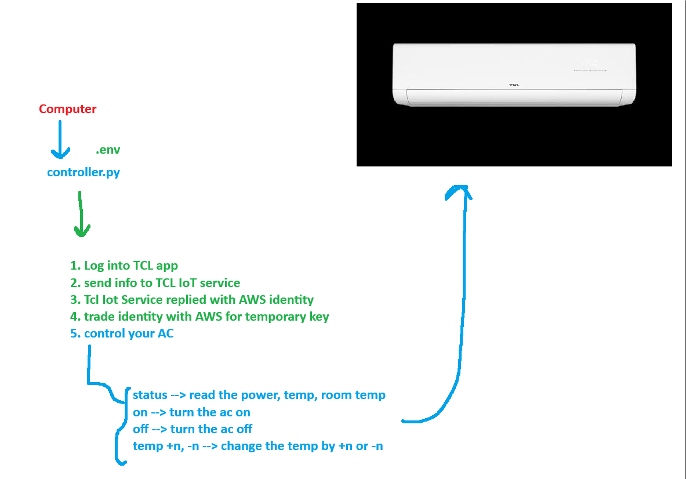

# TCL AC Controller

(unoffical, self made)

## Setup

1. need Python 3.10 +
2. Copy `.env.example` to `.env` in the same folder as `controller.py`.
3. Fill in `.env`:

   ```
   TCL_USERNAME=0812345678
   TCL_PASSWORD=your-password
   TCL_DEVICE_ID=DtR9MSvgAAE
   TCL_PHONE_PREFIX=66
   TCL_COUNTRY=TH
   TCL_TIMEZONE=Asia/Bangkok
   ```

   - `TCL_USERNAME` is the phone number or email you use in the TCL Home app
   - `TCL_DEVICE_ID` i found it on my ac stickers on the right side


## Usage

```
py controller.py status     show power, set temperature and room temperature
py controller.py on         turn the AC on
py controller.py off        turn the AC off
py controller.py temp +1    raise the temperature by 1 (use -1 to lower it)
```

(temperature always in between 16 and 30 (its locked by TCL) )

## How it works


TCL has no public API, so this script request the TCL home app

1. **Log in.** It sends your username and an MD5 hash of your password to `pa.account.tcl.com`,
   using the same headers as the Android app. TCL returns a login token, which is saved in
   `.tcl_token.json` and reused until it is close to expiring.
2. **Get an AWS identity.** It sends the token to TCL's IoT service (`loadBalance`). The request
   is signed with `md5(timestamp + nonce)`. TCL replies with an AWS Cognito identity and the
   address of the AWS IoT server for your account.
3. **Get AWS keys.** It exchanges that identity with AWS Cognito for temporary AWS keys.
4. **Talk to the AC.** The AC is controlled through an AWS IoT "device shadow", a JSON copy
   of the AC's state kept in the cloud.
   - `status` reads the shadow.
   - `on`, `off` and `temp` publish a change such as `{"powerSwitch": 1}` or
     `{"targetTemperature": 24}` to `$aws/things/<device id>/shadow/update`.
     The AC picks up the change from the shadow.